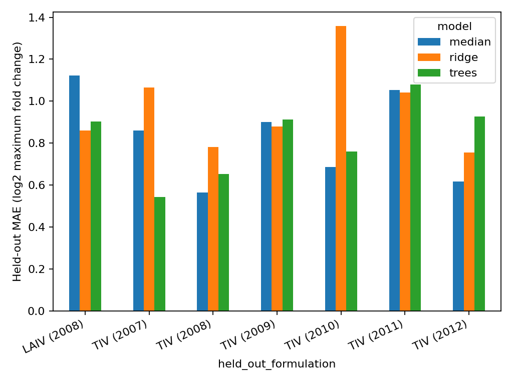

# Can baseline blood expression rank antibody responses to a held-out influenza formulation?

Seven formulation-year groups supplied 365 PBMC participants. Mean held-out Spearman correlation was 0.065 for ridge and 0.013 for extra trees. The formulation-level table shows the variation hidden by these averages.



## Study design

Keep one day-zero sample per participant, HAI fold change measured 21–35 days later, and passing sex-chromosome QC. Exclude every test study from development. Rank genes by training variance after requiring 95% coverage. Impute and scale within each fold. Tune ridge across three grouped development folds. Evaluate fixed-seed trees and training medians against the same people.

Some held-out formulations have only eight or nine people. Seasonal formulations share antigenic backgrounds. The design addresses transfer across represented formulations; extension to other vaccine platforms remains open.

## Reproduce

Use Python 3.12 from this directory in a fresh virtual environment. The analysis downloads the cited public inputs on its first run. Set `BSC_CACHE` to reuse an existing private cache. The offline tests run with the core dependencies.

```sh
python -m pip install -r requirements.txt
python -m unittest discover -v
python verify.py
python analysis.py
```

The checksum command verifies the committed release. Reruns can change benchmark timings, compressed file timestamps and rendered graphics.

## Data and results

- [Primary results](results/fold_metrics.csv)
- [All output tables and figures](results/)
- [Input provenance and checksums](data/sources.json)
- [Protocol](docs/protocol.md)
- [Original data or method](https://doi.org/10.6084/m9.figshare.17096978)

The MIT license covers repository code. Original datasets, model weights and structural coordinates retain the terms of their providers. Only aggregate results are redistributed here.
